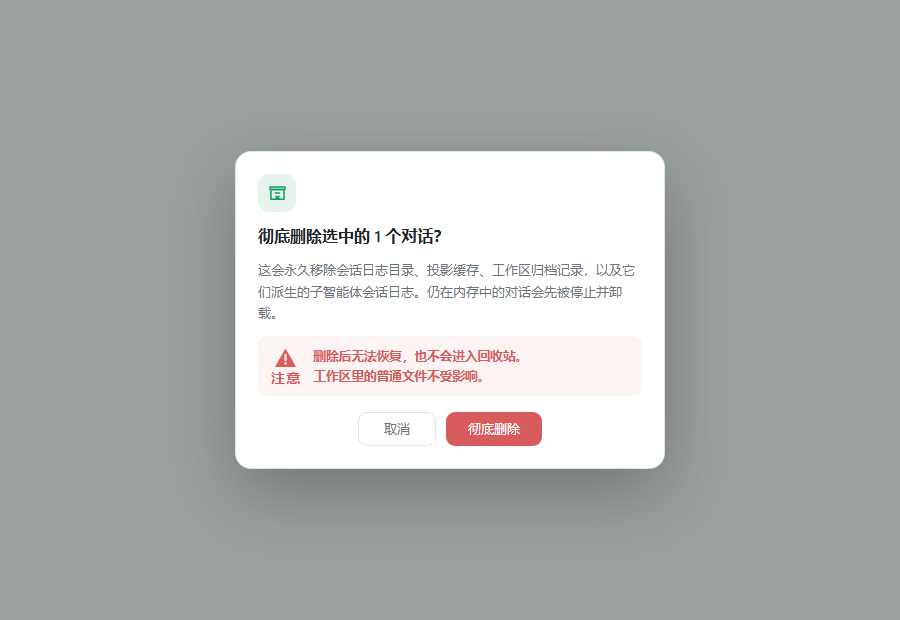

# 归档对话清理 / Archive Cleaner

一个 DSH Web 插件：只列出**默认工作区**里已归档的对话，逐条勾选后把这些对话从本机彻底删除。



## 功能

- 左侧栏「归档清理」入口，主面板显示默认工作区的归档对话。
- 单条勾选、全选、取消全选；「删除选中」带二次确认。
- 删除范围：
  - 会话日志目录（含历史格式代）
  - 会话投影缓存
  - 工作区归档、置顶、会话归属记录
  - 该对话派生的子智能体会话日志
- 仍在内存中的归档对话会先停止并卸载，再删除文件。
- 删除完成后客户端列表同步移除，不会留下「未分组」幽灵行。

## 安装

从 GitHub 安装（把 `web` 换成你的 profile 名）：

```sh
dsh plugin --profile web add github:xinzhi-liu/dsh-archive-cleaner-panel
```

桌面端请在应用内的插件管理里安装同一个 GitHub 地址，然后刷新页面。

安装后左侧栏出现 **「归档清理」**。

## 使用

1. 在侧栏把对话归档。
2. 打开 **「归档清理」**。
3. 勾选一个或多个归档对话。
4. 点击 **「删除选中」**，确认后彻底删除。

## 安全边界

- 只处理**默认工作区**中**已归档**的对话。
- Host 端再次校验归档状态和工作区归属，不信任客户端传入的路径。
- 删除路径必须位于会话存储根目录下，且目录名等于 Session id。
- 全文搜索索引是派生数据库，会在下一次搜索时自动对账。
- 删除不可撤销，不进入回收站；工作区里的普通文件不受影响。

## 要求

- DSH `>=0.2.1-rc.3 <0.3.0`
- Node.js `>=22`
- Web profile；依赖 JSONL 会话持久化后端的 `locate()`

## 开发

```sh
# 在本机 profile 中 link 此目录
pnpm --dir "$DSH_PROFILE_DIR" add link:<绝对路径>
```

## License

MIT
